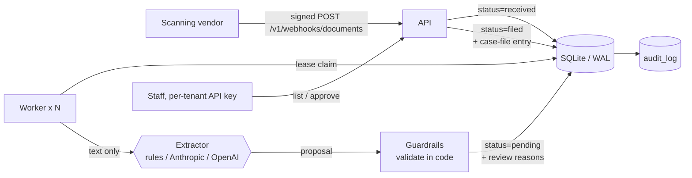

# Architecture and contract

This file is the contract every contributor (human or agent) builds against. Code that disagrees with it is a bug;
a contract that turns out to be wrong is changed here first, then in code.

## Flow



The model proposes; code decides what is stored; a human decides what is filed.

## Data model (`intakeguard/sql/schema.sql`)

| Table | Key | Notes |
|---|---|---|
| `tenants` | `tenant` | unique `inbox`, webhook secret, SHA-256 of the review API key |
| `claimants` | `(tenant, claimant_id)` | IDs are unique per tenant only: `C-101` exists in both demo tenants and is two people |
| `documents` | `(tenant, document_id)` | status, extracted fields, `needs_review`, `review_reasons` (JSON), `injection_suspected`, lease columns, `attempts` |
| `case_file_entries` | `(tenant, document_id)` | one entry per document, ever; who approved it |
| `audit_log` | autoincrement | `received`, `extracted`, `filed` events with actor and detail |

Every query on tenant data filters by `tenant`. Connections use WAL, `busy_timeout=5000` and foreign keys.

## Status machine

`received -> processing -> pending -> filed`

- `processing` is a lease: `lease_owner` + `lease_expires_at`. An expired lease can be reclaimed by any worker.
- After `INTAKEGUARD_MAX_ATTEMPTS` claims a document is parked as `pending` with `max_attempts_exceeded`.

## Interfaces

```python
# intakeguard/extractors/base.py
class Extractor(Protocol):
    name: str
    def extract(self, text: str) -> Any: ...          # text only; may return garbage or raise

class TransientExtractorError(Exception): ...         # timeouts, 429, 5xx -> retried with backoff

# intakeguard/guardrails.py   (the ONE path used by the worker and by the evals)
def extract_and_check(text: str, valid_claimant_ids: set[str], extract: Callable[[str], Any]) -> CheckedExtraction

# intakeguard/worker.py
def process_once(db_path=None, extractor=None, worker_id=None, now=time.time, sleep=time.sleep) -> int

# intakeguard/api.py
def create_app(db_path: str | None = None) -> FastAPI   # run: uvicorn intakeguard.api:create_app --factory
```

## Guardrail rules (`intakeguard/guardrails.py`)

| Extractor answer | Stored fields | `needs_review` | reason |
|---|---|---|---|
| valid, claimant of this tenant | as proposed | false | — |
| valid, `claimant_id` null | as proposed | true | `no_claimant` |
| not an object / missing key / wrong type | all null | true | `not_an_object`, `missing_key:*`, `claimant_wrong_type` |
| unknown `document_type` | all null | true | `unknown_document_type` |
| date not `YYYY-MM-DD` or not a real date | all null | true | `date_wrong_format`, `date_not_a_calendar_date` |
| claimant not in this tenant (incl. hallucinated) | all null | true | `claimant_not_in_tenant` |
| extractor raised (after retries) | all null | true | `extractor_error:<Type>` |
| text looks like a prompt injection | unchanged | true | `possible_prompt_injection` (added) |

## HTTP

| Route | Auth | Behaviour |
|---|---|---|
| `POST /v1/webhooks/documents` | HMAC | 413 body > 1 MB; 400 bad JSON / missing or non-string field / bad `document_id`; 404 unknown inbox; 403 missing, stale (> 300 s) or wrong signature; 200 `{document_id, status, duplicate}`. Never calls the extractor. |
| `GET /v1/tenants/{t}/documents` | Bearer key of `t` | filters `status`, `needs_review`; `limit` (≤500), `offset`; ordered by `document_id` |
| `GET /v1/tenants/{t}/documents/{id}` | Bearer key of `t` | fields + reasons + audit trail |
| `POST /v1/tenants/{t}/documents/{id}/approve` | Bearer key of `t` | 404 unknown doc; 409 no confirmed claimant; 200 idempotent (one case-file entry even under concurrent calls) |
| `GET /healthz`, `GET /metrics` | none | liveness; Prometheus text |

Missing or invalid key: 401. A valid key used against another tenant's URL: 404, so tenants cannot be enumerated.
`document_id` must match `[A-Za-z0-9][A-Za-z0-9._:/-]{0,127}`; slashes are allowed and routable.

Signature: `X-Timestamp: <unix seconds>`, `X-Signature: hex(HMAC-SHA256(secret, "<timestamp>." + raw_body))`.
